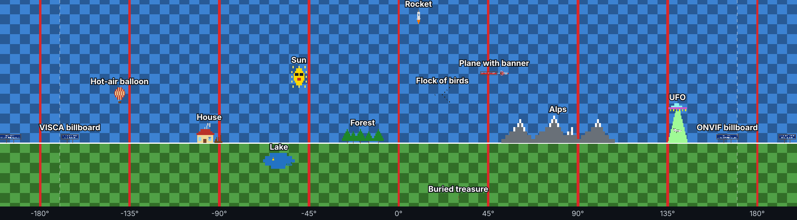

<!--
SPDX-FileCopyrightText: 2026 Stephan Strittmatter
SPDX-License-Identifier: MIT
-->

# ptzsim – command-line PTZ camera simulator

[](https://github.com/stritti/ptz-simulator/actions/workflows/ci.yml)
[](https://stritti.github.io/ptz-simulator/)
[](https://github.com/stritti/ptz-simulator/actions/workflows/ci.yml)
[](https://github.com/stritti/ptz-simulator/releases/latest)
[](https://pypi.org/project/ptzsim/)
[](https://github.com/stritti/ptz-simulator/blob/main/pyproject.toml)
[](https://github.com/stritti/ptz-simulator/blob/main/LICENSE)
[](https://www.conventionalcommits.org/en/v1.0.0/)
[](https://skills.sh/stritti/ptz-simulator)

Simulates a PTZ camera controlled via **ONVIF**, **VISCA** and **NDI**, so PTZ
clients can be tested without a real camera. All protocols control the same
camera. The simulator keeps the camera state (pan, tilt, zoom, focus, presets,
power) and shows it live in the terminal.

ONVIF and VISCA need nothing but Python ≥ 3.8 (standard library only). NDI
additionally needs the `ndi` extra (see [NDI](#ndi)). The project is managed
with [uv](https://docs.astral.sh/uv/): `uv sync` creates `.venv` with the dev
dependencies.

## Supported standards

The simulator implements these standards. The exact operations are listed under
[ONVIF scope](#onvif-scope), [Supported VISCA commands](#supported-visca-commands)
and [NDI](#ndi); protocols that are not implemented are listed under
[Unsupported protocols](#unsupported-protocols).

| Standard | Version | Reference |
|---|---|---|
| ONVIF Core Specification (device service, WS-Discovery) | v26.06 | [ONVIF-Core-Spec-v2606.pdf](https://www.onvif.org/specs/2606/ONVIF-Core-Spec-v2606.pdf) |
| ONVIF PTZ Service Specification | v25.12 | [ONVIF-PTZ-Service-Spec-v2512.pdf](https://www.onvif.org/specs/2512/ONVIF-PTZ-Service-Spec-v2512.pdf) |
| ONVIF Imaging Service Specification (white balance only) | v18.12 | [ONVIF-Imaging-Service-Spec-v1812.pdf](https://www.onvif.org/specs/srv/img/ONVIF-Imaging-Service-Spec-v1812.pdf) |
| WS-Discovery on UDP multicast 239.255.255.250:3702 (ONVIF Core spec ch. 7) | WS-Discovery 1.0, April 2005 (`http://schemas.xmlsoap.org/ws/2005/04/discovery` namespace) | [WS-Discovery 1.0 spec (2005/04)](https://schemas.xmlsoap.org/ws/2005/04/discovery/) |
| HTTP digest authentication (ONVIF Core spec ch. 5.9.1) | RFC 2617 | [RFC 2617](https://www.rfc-editor.org/rfc/rfc2617) |
| WS-Security UsernameToken with PasswordDigest/Text (ONVIF Core spec ch. 5.9.5) | OASIS wss 1.1 | [UsernameToken Profile 1.1](https://docs.oasis-open.org/wss/v1.1/wss-v1.1-spec-pr-UsernameTokenProfile-01.htm) |
| Sony VISCA command set (classic 4-digit BRC/EVI/Axis commands) | VISCA command list v2.00 | [Sony ILME-FR7 VISCA command list v2.00](https://pro.sony/s3/2022/09/14131603/VISCA-Command-List-Version-2.00.pdf), [Axis VISCA interface description](https://www.axis.com/dam/public/70/3d/31/visca-interface-api-description-en-US-266656.pdf) |
| Sony VISCA over IP (8-byte header, UDP 52381) | per the Sony technical manuals | [BRC-X400/SRG-X400 technical manual](https://sony.net/Products/CameraSystem/CA/BRC_X400_SRG_X400/Technical_Document/E042100011.pdf), [BRC-X1000/BRC-H800 command list](https://sony.net/Products/CameraSystem/CA/BRC_X1000_BRC_H800/Technical_Document/C456100111.pdf) |
| NDI PTZ control (XML metadata `ntk_ptz_*`) | NDI SDK (runtime via ndi-python 5.1/6.3) | [NDI "PTZ and Control Messages"](https://docs.ndi.video/all/developing-with-ndi/ndi-metadata/ptz-and-control-messages), [NDI SDK](https://ndi.video/), [ndi-python](https://pypi.org/project/ndi-python/) |

## Installation

ptzsim needs only Python ≥ 3.8. Pick one:

```bash
# Single file, nothing to install: download and run with any Python 3
curl -LO https://github.com/stritti/ptz-simulator/releases/latest/download/ptzsim.pyz
python3 ptzsim.pyz serve --onvif          # Windows: py ptzsim.pyz serve --onvif

# As a command on the PATH (with uv or pipx)
uv tool install git+https://github.com/stritti/ptz-simulator
pipx install git+https://github.com/stritti/ptz-simulator
ptzsim serve --onvif
```

Wheel, sdist and `ptzsim.pyz` of every version are attached to the
[GitHub releases](https://github.com/stritti/ptz-simulator/releases). For NDI,
install the extra: `uv tool install "ptzsim[ndi] @ git+https://github.com/stritti/ptz-simulator"`.

## Supported transports

| Option           | Protocol                                             | Default port |
|------------------|------------------------------------------------------|--------------|
| `--onvif [PORT]` | ONVIF (SOAP over HTTP) + WS-Discovery on UDP 3702    | 8080         |
| `--sony [PORT]`  | Sony VISCA over IP (UDP, 8-byte header)              | 52381        |
| `--tcp [PORT]`   | raw VISCA over TCP (e.g. PTZOptics)                  | 5678         |
| `--udp [PORT]`   | raw VISCA over UDP                                   | 1259         |
| `--pty [LINK]`   | serial VISCA via a pseudo terminal (RS-232/422 stand-in) | –        |
| `--pelco-d [LINK]` | Pelco-D serial via a pseudo terminal (RS-485 stand-in) | –      |
| `--ndi`          | NDI source with PTZ control and a test picture       | NDI default (mDNS, TCP 5960+) |

Transports can be combined; they all control the same camera. Without any option
`--sony` is started.

## Running

```bash
cd ptz-simulator
uv run ptzsim serve --onvif --onvif-user admin --onvif-password secret   # ONVIF with authentication
uv run ptzsim serve --onvif --sony       # ONVIF and VISCA at the same time
uv run ptzsim serve                      # Sony VISCA/IP on UDP 52381
uv run ptzsim serve --tcp --sony         # TCP 5678 and UDP 52381
uv run ptzsim serve --pty /tmp/ttyPTZ    # serial port at /tmp/ttyPTZ
uv run --extra ndi ptzsim serve --ndi --name "Camera 1"  # NDI source "HOSTNAME (Camera 1)"
uv run ptzsim serve --view-only          # dashboard without keyboard control
uv run ptzsim serve --no-tui -v          # line log instead of the dashboard
```

Without uv, `python3 -m ptzsim serve ...` works as well (standard library only).

More options: `--onvif-auth both|digest|wsse` (HTTP digest and/or WS-UsernameToken,
default both), `--onvif-no-absolute` (camera without `AbsoluteMove`, presets only via
`SetPreset`/`GotoPreset`), `--address 1..7` (VISCA address), `--instant` (jump to target
positions instead of moving at motor speed), `--host` (bind address). In
dashboard mode, log messages go to `ptzsim.log`.

## Dashboard and Network Discovery

### TUI Dashboard Views
The interactive TUI uses a Midnight-Commander-style layout: the active view and
tabs stay at the top, while status feedback and the command bar stay fixed at the
bottom, including the terminal's last row. Only the content between them scrolls.
The active tab is highlighted and marked with brackets, even without color.

#### Camera Control View (Press `c`)
The main camera control view shows real-time PTZ status and commands:
```
CAMERA | PTZ camera simulator
[c]:Camera  n:Network  | ONVIF http://0.0.0.0:8103/onvif/device_service
Power: ON   Address: 1   Commands: 0

Pan        0     +0.0°  [──────────────●───────────────]  idle
Tilt       0     +0.0°  [───────●──────────────────────]  idle
Zoom  0x0000      1.0x  [●─────────────────────────────]  idle
Focus 0x8000        AF  [──────────────●───────────────]  idle
White balance  auto          R 0x80  B 0x80

No presets stored

Last commands
(waiting for commands)

Speed 4/8 | Ready
MOVE                                     PRESET                   CAMERA                 VIEW
[Arrows/WASD] Pan/Tilt                   [1-9]        Recall      [f] Autofocus          [c]         Camera
[+/-]         Zoom      [h]   Home       [P then 1-9] Save        [b] White balance      [n]         Network  [?] Help
[Space]       Stop      [ / ] Speed      [C then 1-9] Clear       [o] Power              [PgUp/PgDn] Scroll   [q] Quit
```

#### Network Information View (Press `n`)
Lists the hostname and every network interface of the machine (also interfaces
that are down or have no address), the main interfaces first:
```
NETWORK | Network Information
c:Camera  [n]:Network  | ONVIF http://0.0.0.0:8103/onvif/device_service

Hostname: camera-host
FQDN:     camera-host.example.test

Interfaces (24)
  Interface        State  IPv4                IPv6
  eth0             up     192.0.2.10/24       fe80::1
  br-0123456789ab  down   172.18.0.1/16
  br-abcdef012345  up     172.19.0.1/16       fe80::2
  docker0          down   172.17.0.1/16       fe80::3
  lo               up     127.0.0.1/8
  veth0123456      up                         fe80::4
  ...

Speed 4/8 | Ready
MOVE                                     PRESET                   CAMERA                 VIEW
[Arrows/WASD] Pan/Tilt                   [1-9]        Recall      [f] Autofocus          [c]         Camera
[+/-]         Zoom      [h]   Home       [P then 1-9] Save        [b] White balance      [n]         Network  [?] Help
[Space]       Stop      [ / ] Speed      [C then 1-9] Clear       [o] Power              [PgUp/PgDn] Scroll   [q] Quit
```

### Keyboard Shortcuts
The bottom command bar uses four compact columns for movement, presets, camera
settings and view navigation, separated by six spaces. Key labels are highlighted
and enclosed in brackets:
- **`n`** - Network Information View (IP addresses, interfaces, hostname)
- **`c`** - Camera Control View (PTZ controls, presets, commands)
- **`q`** - Quit the simulator (or use Ctrl+C)
- **`?`** - Open/close the full keyboard help; `Esc` also closes it
- **`PgUp` / `PgDn`** - Scroll long camera, network or help content; the status
  line shows the visible line range when content overflows

The interactive TUI requires at least **120 columns and 8 rows**. If the
terminal is smaller, a resize notice replaces the dashboard; `Space` (stop)
and `q` (quit) remain available. Resizing back restores the current view and
any pending preset action. On terminals 8 to 14 rows high, the bottom bar keeps
Stop, Help and Quit visible. Open `?` for the complete command list.
Camera controls remain available in Network view. In Help, camera commands are
paused except for `Space` (stop); `c` or `n` returns directly to that view.

### Startup Information
When the simulator starts, it displays comprehensive network information in the startup logs:
- **Hostname and FQDN** (e.g., `camera-host` and `camera-host.example.test`)
- **All Network Interfaces** with their IP addresses:
  - IPv4 addresses with netmasks (e.g., `eth0: 192.0.2.10/255.255.255.0`)
  - IPv6 addresses (e.g., `eth0: fe80::1`)
- **Summary of available addresses** in log output (`Available on: …`, main interface
  first, without loopback and link-local addresses)

The network addresses are detected automatically from the system's network
interfaces with `getifaddrs(3)` (Linux, macOS, BSD; no extra packages). Where
`getifaddrs` is not available (Windows), the simulator falls back to the addresses
of the hostname. Hostname/FQDN and DNS-derived fallback addresses are a startup
snapshot; DNS resolution runs outside the event loop so it cannot stall camera
control. Native interface information remains live.

### Health-Check API
The simulator provides a health-check endpoint at `/health` (or `/`). Without
configured ONVIF credentials, it returns detailed JSON information:

```bash
curl http://127.0.0.1:8080/health
```

Response example:
```json
{
    "status": "ok",
    "camera": "PTZ-Simulator",
    "hostname": "camera-host",
    "fqdn": "camera-host.example.test",
    "address": "192.0.2.10",
    "port": 8080,
    "interfaces": [
        {
            "name": "eth0",
            "ipv4": ["192.0.2.10"],
            "ipv6": ["fe80::1"]
        },
        {
            "name": "docker0",
            "ipv4": ["172.17.0.1"],
            "ipv6": ["fe80::3"]
        }
    ]
}
```

Clients can use this endpoint to:
- Verify connectivity to the simulator
- Discover available network interfaces
- Identify the correct IP address to use for the connection
- Get the hostname and FQDN for display purposes

The `interfaces` list contains up to 10 interfaces with an address, main
interfaces first.

With `--onvif-user`, ordinary health requests return only `{"status":"ok"}`.
Request `?details=1` to retrieve network details with HTTP Digest authentication
in the `both` or `digest` auth mode:

```bash
curl --digest --user admin 'http://127.0.0.1:8080/health?details=1'
```

curl prompts for the password. `/?details=1` is an alias. Missing or invalid
credentials receive a `401` challenge; WSSE-only mode rejects detail requests
with `403`, without changing SOAP authentication. The `details` parameter must
appear once with value `1`; invalid values receive `400`.

Network lookups for detailed responses run outside the simulator event loop,
so health polling cannot delay camera control or movement timeouts.

## Keyboard control (TUI)

In a terminal, `serve` shows the live dashboard and lets you drive the camera
from the keyboard. Your actions show up in the command log as `TUI`, next to the
commands from ONVIF, VISCA or NDI clients, and they change the same camera, so the
camera state is shared with every connected client. ONVIF clients can read the
current position using `GetStatus`.

| Key | Action |
|-----|--------|
| `n` / `c` | show network information / return to the camera view (no Enter needed) |
| arrows or `W` `A` `S` `D` | pan/tilt while the key is held (stops ~0.35 s after the last key repeat) |
| `+` / `-` | zoom tele / wide while the key is held |
| space | stop all movement |
| `[` / `]` | jog speed down / up (1–8) |
| `h` | home position |
| `1`–`9` | recall preset |
| `P` then `1`–`9` | save the current position as preset |
| `C` then `1`–`9` | clear preset |
| `f` | toggle autofocus |
| `b` | one-push white balance (sets gains to neutral, locks manual) |
| `o` | power on / standby |
| `q` | quit |
| `?` / `Esc` | toggle help / close help or cancel a pending preset action |
| `PgUp` / `PgDn` | scroll the current view or help |

View switching uses lowercase `n` and `c`; uppercase `C` still clears a preset.
The network view uses the full width without the camera picture. Returning with
`c` restores the camera layout without resetting the camera or its presets.

Next to the dashboard, when there is enough vertical space, the TUI shows the
**camera picture** at the current position: the same virtual scene as the NDI test
picture, drawn with text characters. The horizon is at 0° tilt, the ground has a
5° checker pattern, a post with its angle stands every 45° of pan, and a 1° grid
appears when zoomed in. The field of view is 60° at 1× and narrows with the zoom
(3° at 20×); the caption shows pan, tilt and zoom. Moves from any client show up
in the picture as they happen.
The picture is omitted on short terminals so status and commands stay visible.

The landscape has landmarks at fixed coordinates, so you can check by eye that a
client's absolute moves and presets land where they should. Small details (↳) only
become readable when you zoom in:



<!-- scene-tour:start -->
| Landmark | Pan | Tilt | Zoom |
|---|---|---|---|
| Alps | 80° | 6° | 1× |
| ↳ Summit cross | 78.2° | 14.1° | 20× |
| Forest | −18° | 4° | 1.5× |
| ↳ Fox | −14.3° | 0.4° | 10× |
| House | −95° | 5° | 1.5× |
| Sun | −50° | 32° | 2× |
| Flock of birds | 22° | 24° | 2× |
| ↳ Straggler | 17.8° | 24.7° | 15× |
| Plane with banner | 48° | 35.5° | 2.5× |
| UFO | 140° | 10° | 1.5× |
| ↳ Abducted cow | 140° | 6° | 5× |
| Hot-air balloon | −140° | 24° | 2× |
| Lake | −60° | −9° | 2× |
| ↳ Rubber duck | −63° | −7.9° | 12× |
| ↳ Lake monster | −55° | −10.2° | 8× |
| VISCA billboard | −165° | 2.5° | 4× |
| ONVIF billboard | 165° | 2.5° | 4× |
| Rocket | 10° | 63° | 2× |
| Buried treasure | 30° | −27.5° | 4× |
<!-- scene-tour:end -->

The billboards stand behind the camera, near the pan limits (±170°). The
*Camera scene* page of the documentation website (`docs/scene.md`) shows every
landmark in the NDI picture and in the viewfinder, with the VISCA packets and ONVIF
`AbsoluteMove` values to get there. `scripts/scene_docs.py` generates the tables
and images from `ptzsim/scenery.py`.

The keyboard UI uses `curses` and needs a terminal, so it is not available on
native Windows Python (use WSL) or when stdin/stdout are redirected; `serve` then
falls back to the read-only dashboard. On Unix, that dashboard still accepts
`n`, `c` and `q` for view navigation and quitting. Closed or unavailable stdin
only disables keyboard input; it does not stop the simulator. On native Windows,
use Ctrl+C to exit the read-only dashboard.

## Testing ONVIF clients

1. Start the simulator in the same network as the client:
   `uv run ptzsim serve --onvif --onvif-user admin --onvif-password secret --name "Camera 1"`.
   For several cameras, start several instances with their own port and name
   (`--onvif 8081 --name "Camera 2"`); all of them answer WS-Discovery.
2. Search for cameras with an ONVIF client. The simulator answers the
   WS-Discovery probe (`dn:NetworkVideoTransmitter`) with the XAddr
   `http://<ip>:8080/onvif/device_service` and the name in the scope
   `onvif://www.onvif.org/name/<name>`. Alternatively enter the simulator's IP
   and port directly. Use the user and password from above.
3. Use the client to pan, tilt, zoom, save and recall presets. The dashboard shows
   position, motion, presets and the latest commands.

If a client runs in Docker/WSL and multicast discovery fails, enter the
simulator's address directly. Set `--advertise-host <IP>` if the address
advertised by discovery is not reachable by the client. Port 80 (the ONVIF
default) needs root privileges, so 8080 is the default.

## ONVIF scope

- **Device**: `GetCapabilities`, `GetServices`, `GetSystemDateAndTime`, `GetDeviceInformation`,
  `GetWsdlUrl`, `GetEndpointReference`, `GetUsers` (the `--onvif-user` as Administrator).
  Scopes: `GetScopes`, `SetScopes`, `AddScopes`, `RemoveScopes` (type, profile and hardware
  are fixed, name and location configurable; WS-Discovery announces the current list),
  `GetDiscoveryMode`/`SetDiscoveryMode` (`NonDiscoverable` stops Hello and ProbeMatches).
  Network: `GetHostname`/`SetHostname`, `GetNetworkInterfaces` (`eth0` with the address the
  client connected to), `GetDNS`, `GetNTP`, `GetNetworkProtocols` (HTTP), `GetNetworkDefaultGateway`.
  `SetNetworkInterfaces`, `SetDNS`, `SetNTP`, `SetNetworkProtocols`, `SetNetworkDefaultGateway`,
  `SetSystemDateAndTime`, `SetSystemFactoryDefault` and `SystemReboot` are accepted but change
  nothing. User management (`CreateUsers`, `SetUser`, `DeleteUsers`) is not supported.
- **Media**: one fixed profile `Profile_1` with a video source configuration
  (`VideoSourceConfig_1`, 640×360), an H.264 encoder configuration (`VideoEncoderConfig_1`) and
  the PTZ configuration (including `DefaultContinuousZoomVelocitySpace`). `GetProfiles`/`GetProfile`,
  `Get(Compatible)VideoSourceConfiguration(s)`, `GetVideoSourceConfigurationOptions`,
  `SetVideoSourceConfiguration`, `Get(Compatible)VideoEncoderConfiguration(s)`,
  `GetVideoEncoderConfigurationOptions`, `SetVideoEncoderConfiguration` (stores resolution
  640×360/320×180, quality 0…10, frame rate 1…25, bitrate, GOV length, H.264 profile; other
  values give `ter:ConfigModify`), `GetGuaranteedNumberOfVideoEncoderInstances`,
  `Add`/`Remove` `VideoSource`/`VideoEncoder`/`PTZ` `Configuration`. `GetStreamUri` returns
  `--rtsp-uri` (default `rtsp://<host>:554/stream`); ptzsim does not stream video itself, and
  without a source and encoder in the profile it fails with `ter:IncompleteConfiguration`.
  After `RemovePTZConfiguration`, PTZ moves, status and presets fail with `ter:NoPTZProfile`.
  `GetSnapshotUri` is not supported (`SnapshotUri="false"`).
- **PTZ**: `ContinuousMove` (with `Timeout`, default 5 s; every new call extends it),
  `Stop`, `AbsoluteMove`, `RelativeMove`, `GetStatus`, `GotoHomePosition`, `SetHomePosition`,
  `GetPresets`, `SetPreset`, `GotoPreset`, `RemovePreset`, `GetNodes`, `GetConfigurations`,
  `GetConfigurationOptions`, `GetCompatibleConfigurations`
- **Authentication**: HTTP digest and/or WS-Security UsernameToken with `PasswordDigest`
  (or `PasswordText`), only when `--onvif-user` is set. Missing or wrong digest credentials
  get HTTP 401 with a new challenge. `GetCapabilities`, `GetServices`, `GetServiceCapabilities`,
  `GetWsdlUrl`, `GetHostname`, `GetEndpointReference` and `GetSystemDateAndTime` work without
  login, as on real cameras.
- **Imaging** (white balance only): `GetImagingSettings`, `SetImagingSettings` and `GetOptions`
  for video source `VideoSource_1`, mode `AUTO`/`MANUAL`, gains 0…255/128 (1.0 = VISCA 0x80). Media
  `GetVideoSources` lists `VideoSource_1` (640×360, 25 fps). `GetMoveOptions` and `GetStatus`
  answer empty (no remote focus); imaging `Move`/`Stop` return `ter:ActionNotSupported` and
  never touch the PTZ unit. ONVIF has no
  one-push trigger, so one push is only available via VISCA, NDI and the `b` key.
- Not supported: Events, Media2. These calls return a SOAP fault
  (`ter:ActionNotSupported`); Events are also missing from `GetCapabilities`.

Coordinates use the generic ONVIF spaces: pan −1…1 (≈ ±170°), tilt −1…1
(−1 = −30°, 0 = level, 1 = +90°), zoom 0…1 (1×…20×), velocities −1…1.
VISCA and ONVIF presets are the same. The ONVIF token and the NDI index are the VISCA wire value (0–99, hex `00`–`63`); the dashboard and the keys 1–9 show it as 1–100. Recall uses the preset speed setting; ONVIF `GotoPreset` with a `Speed` element overrides it.

## Testing VISCA clients

Start the simulator with `--sony`, `--tcp`, `--udp` or `--pty /tmp/ttyPTZ` and
enter the IP and port in the client (52381 for Sony VISCA/IP, 5678 for
VISCA/TCP), or `/tmp/ttyPTZ` as the serial port.

## Checking a client in your test suite

`ptzsim.testing` starts the simulator inside your own tests (same arguments as
`ptzsim serve`) and asserts on the camera model after your client has driven it:

```python
from ptzsim.testing import assert_no_errors, assert_stopped, free_port, serve

async with serve("--onvif", str(port), "--no-discovery") as ctx:
    ...                               # drive 127.0.0.1:port with the client under test
    assert_stopped(ctx.camera.state)  # no axis still moving after Stop
    assert_no_errors(ctx.camera)      # no VISCA error, VISCA/IP control error or ONVIF fault
```

This catches the usual client pitfalls: an axis left out of an ONVIF `ContinuousMove`
keeps moving (only velocity 0 stops it), a tilt speed above `0x17` is a VISCA syntax
error (`90 60 02 FF`), and a VISCA over IP message answered with the control reply
`0F 01` / `0F 02` gets no ACK or completion. Control errors are also shown in the
command log. The [agent skill](docs/skills.md) `ptz-conformance-testing` has the full
client-side checklist.

## Testing Pelco-D clients

Start the simulator with `--pelco-d [LINK]` (e.g. `--pelco-d /tmp/ttyPelcoD`) and
open the printed pseudo terminal as the serial port in the client (2400–38400
baud, 8N1; the simulator does not check the baud rate). The Pelco-D camera
address is 1–255 (`--pelco-d-address`, default 1); frames for other addresses
are ignored silently, as on a real RS-485 bus.

Frames are 7 bytes: `FF <addr> <cmd1> <cmd2> <data1> <data2> <checksum>`, where
`checksum = (addr + cmd1 + cmd2 + data1 + data2) mod 256`. Every executed command
is answered with the 4-byte general response `FF <addr> 00 <checksum>`: the alarm
byte is `00` and the checksum is the request checksum plus the alarm byte (e.g.
`FF 01 00 02 20 00 23` is answered with `FF 01 00 23`, focus near
`FF 01 01 00 00 00 02` with `FF 01 00 02`). A frame with a wrong checksum, with
contradicting direction bits (left + right, up + down, tele + wide, near + far,
iris open + close) or with an unsupported command gets no reply. Implemented commands:

| Command | Bytes | Effect |
|---|---|---|
| Drive | `FF a <cmd1> <bits> <pan spd> <tilt spd> chk` | cmd2 bits (bit 0 = 0): 0x02 pan right, 0x04 pan left, 0x08 tilt up, 0x10 tilt down, 0x20 zoom tele, 0x40 zoom wide, 0x80 focus far; cmd1 bit 0 focus near (`FF a 01 00 00 00 chk`), bits 1/2 iris open/close (acknowledged, not simulated); different axes are combinable |
| Stop all | `FF a 00 00 00 00 chk` | stops pan/tilt/zoom/focus |
| Set preset | `FF a 00 03 00 <n> chk` | saves the current position as preset n (0–99) |
| Call preset | `FF a 00 07 00 <n> chk` | moves to preset n (no response if not set) |
| Clear preset | `FF a 00 05 00 <n> chk` | deletes preset n |
| Set zoom speed | `FF a 00 25 00 <s> chk` | zoom speed for later zoom commands, 0x00 slowest … 0x03 highest (default 0x03) |
| Set focus speed | `FF a 00 27 00 <s> chk` | focus speed for later focus commands, 0x00 slowest … 0x03 highest (default 0x02) |
| Set pan / tilt position | `FF a 00 4B/4D <msb> <lsb> chk` | moves to 0–35999 hundredths of a degree; pan clockwise, tilt 0 = horizon, 9000 = straight down, 27000 = straight up |
| Set zoom position | `FF a 00 4F <msb> <lsb> chk` | zoom to (position / 65535) × zoom limit (20×) |
| Query pan / tilt / zoom position | `FF a 00 51/53/55 00 00 chk` | Extended Response `FF a 00 59/5B/5D <msb> <lsb> chk` in the same units |

A drive frame describes the whole motion state: an axis whose direction bit is
cleared stops (a later zoom-only frame also stops the pan). Speeds are
0x00–0x3F, where 0x00 is the slowest speed (not a stop) and 0x40 is pan turbo
(maximum; every value above 0x3F is treated as maximum), mapped onto the VISCA speed ranges. Zoom and focus speeds are not
taken from the data fields but from Set Zoom Speed / Set Focus Speed. As Pelco
requires for runaway detection, a drive command stops by itself after 15 seconds
unless a new drive command arrives. Focus commands only move the focus in manual
focus mode (like VISCA, they are ignored while autofocus is on). Presets are
the same 100 presets as for VISCA and ONVIF. Positions follow the Pelco "D"
Protocol manual v5.0.1 (sections 5.38–5.47); positions beyond the end stops
(±170° pan, −30…+90° tilt) are clipped. Example: pan right at medium speed on
camera 1 is `FF 01 00 02 20 00 23`.

## NDI

```bash
uv run --extra ndi ptzsim serve --ndi --name "Camera 1"
```

The simulator shows up as the NDI source `HOSTNAME (Camera 1)` and sends a test
picture (640×360, `--ndi-fps`, default 25): a grid with sky, ground, horizon,
red posts every 45° and the same landmarks as the
[TUI camera picture](#keyboard-control-tui) (mountains, house, UFO, billboards, …),
moving with pan, tilt and zoom. It announces PTZ support
(`<ndi_capabilities ntk_ptz="true" .../>` with pan/tilt, zoom, focus, autofocus, white balance and preset speed; NDI preset indexes 0–99, the same 100 presets as VISCA), so NDI Studio Monitor, vMix, OBS
(DistroAV) etc. offer PTZ control.

It executes the NDI PTZ commands that receivers send as metadata:

| Metadata | Effect | Value range (NDI SDK) |
|---|---|---|
| `ntk_ptz_pan_tilt pan tilt` | absolute pan/tilt | −1 left … +1 right, −1 bottom … +1 top |
| `ntk_ptz_pan_tilt_speed pan_speed tilt_speed` | move pan/tilt | +1 = moving left, +1 = moving up |
| `ntk_ptz_zoom zoom` | absolute zoom | 0 = zoomed in … 1 = zoomed out |
| `ntk_ptz_zoom_speed zoom_speed` | move zoom | +1 = inwards, −1 = outwards |
| `ntk_ptz_focus mode="auto"` / `mode="manual" distance` | focus | 0 = infinity … 1 = close |
| `ntk_ptz_focus_speed distance` | move focus | −1 … +1 |
| `ntk_ptz_store_preset index` / `ntk_ptz_recall_preset index speed` | presets | 0…99, speed 0…1 |
| `ntk_ptz_white_balance mode="auto"` / `mode="one_shot"` / `mode="manual" red blue` | white balance | 0…1 for red/blue, 0.5 neutral; `indoor`/`outdoor` fixed modes |
| `ntk_ptz_exposure`, `ntk_ptz_iris` | accepted and logged, not simulated | – |

NDI presets are the same as for VISCA and ONVIF. `ndi-python` ships the NDI
runtime, which is subject to the NDI license terms (NDI® is a trademark of Vizrt
NDI AB). On Linux, NDI discovery uses mDNS. If a receiver does not find the
source, add the simulator's IP as an extra source or in NDI Access Manager.

## Sending commands by hand

```bash
uv run ptzsim send "81 01 06 04 FF"                    # home (Sony VISCA/IP)
uv run ptzsim send --proto tcp "81 01 04 3F 01 05 FF"  # store preset 5
uv run ptzsim send "81 09 06 12 FF"                    # query position
```

## Supported VISCA commands

VISCA commands follow the [Axis VISCA interface description](https://www.axis.com/dam/public/70/3d/31/visca-interface-api-description-en-US-266656.pdf).
The [Sony ILME-FR7 VISCA command list](https://pro.sony/s3/2022/09/14131603/VISCA-Command-List-Version-2.00.pdf)
uses other white balance codes (`04` = ATW).

Commands (reply: ACK `90 4z FF` + completion `90 5z FF`, z = socket; for absolute
moves the completion is sent once the axes of that command have reached the target):

| Command | Bytes |
|---|---|
| Power on / standby | `8x 01 04 00 02/03 FF` |
| Zoom stop / tele / wide / variable | `8x 01 04 07 00/02/03/2p/3p FF` |
| Zoom direct | `8x 01 04 47 0p 0q 0r 0s FF` |
| Focus stop / far / near / variable | `8x 01 04 08 00/02/03/2p/3p FF` |
| Focus direct | `8x 01 04 48 0p 0q 0r 0s FF` |
| Auto focus / manual / toggle | `8x 01 04 38 02/03/10 FF` |
| One push AF | `8x 01 04 18 01 FF` |
| White balance mode (00 auto, 01 indoor, 02 outdoor, 04 auto outdoor, 05 manual) | `8x 01 04 35 0p FF` |
| Red / blue gain, relative and absolute | `8x 01 04 03/04 0p FF`, `8x 01 04 43/44 00 00 0p 0q FF` |
| One push white balance | `8x 01 04 10 05 FF` |
| Preset reset / set / recall (pp hex 00–63 = 0–99, shown as 1–100) | `8x 01 04 3F 00/01/02 pp FF` |
| Preset speed select (1 separate, 2 common) | `8x 01 7E 04 1B 0p FF` |
| Common preset speed (01–32 hex) | `8x 01 7E 04 1C 0p 0p FF` |
| Separate preset speed (01–32 hex) | `8x 01 7E 01 0B pp qq FF` |
| Pan/tilt drive (up, down, left, right, diagonal, stop) | `8x 01 06 01 VV WW XX YY FF` |
| Pan/tilt absolute / relative | `8x 01 06 02/03 VV WW 0Y0Y0Y0Y 0Z0Z0Z0Z FF` |
| Home / reset | `8x 01 06 04 FF` / `8x 01 06 05 FF` |
| Command cancel | `8x 2z FF` (z = socket) |
| IF_Clear | `8x 01 00 01 FF`, `88 01 00 01 FF` |
| Address set (takes address w, answers `88 30 0w+1 FF`) | `88 30 0w FF` |

Inquiries (reply `90 50 ... FF`): power `09 04 00`, zoom `09 04 47`,
focus `09 04 48`, focus mode `09 04 38`, white balance mode `09 04 35`, preset speed `09 7E 04 1B`, `09 7E 04 1C`, `09 7E 01 0B`,
pan/tilt position `09 06 12`, max speed `09 06 11`,
pan/tilt status `09 06 10`, version `09 00 02`.

Like Sony cameras the simulator has two command sockets. A command takes the lowest
free socket (`90 41 FF`, then `90 42 FF`); a socket stays busy until its absolute
move, home or preset recall has finished. A command that arrives while both sockets
are busy is answered with "command buffer full" `90 60 03 FF`. A newer move takes
over the axes of an older one; an older command left without axes completes at once; inquiries and
`IF_Clear` do not use a socket. `8x 2z FF` cancels socket z (`90 6z 04 FF`, no
completion follows) or answers "no socket" `90 6z 05 FF`. `IF_Clear` answers
`90 50 FF` (broadcast: `88 01 00 01 FF`) without ACK, stops all motion and empties
both sockets, so no completion follows.

Errors: syntax error `90 60 02 FF`, not executable `90 6z 41 FF` (e.g. standby,
preset not set, or manual focus `04 08`/`04 48` while auto focus is on). Pan/tilt status
reports "initialization completes" (`20 00`) plus "operating" (`04 00`) or
"operations complete" (`08 00`) and the end-stop bits. In absolute/relative moves
tilt speed `00` means "same as pan", and both 4- and 5-digit coordinates are
accepted (classic BRC/EVI/Axis and newer Sony models).

Sony VISCA/IP (per the Sony VISCA command list, chapter VISCA over IP): the control
command `RESET` (`02 00`) is acknowledged with `02 01 ... 01` and resets the
sequence number; replies carry the sequence number of the request. A repeated
sequence number is not executed again and answered with control reply `0F 01`, a
payload type that does not match the packet (inquiry sent as command or vice versa)
with `0F 02`. A message that was answered with a VISCA error was not performed, so
its retransmission with the same sequence number is executed again. The camera address is fixed to 1 over IP: any address is accepted and
replies always come from `90`.

**VISCA is not one standard.** The transport (VISCA over IP, replies, error codes,
sockets) is common to Sony cameras, the command set differs per model. The simulator
follows the classic 4-digit Sony BRC/EVI and Axis command set; check the command
list of the target camera before relying on model-specific commands (e.g. white
balance codes, speed ranges, 5-digit positions on newer Sony models).

Value ranges: pan −2448…2448 (≈ ±170°), tilt −432…1296 (≈ −30…+90°),
zoom 0x0000…0x4000 (1×…20×), focus 0x1000…0xF000, pan speed 1…0x18,
tilt speed 1…0x17, presets 0…99 / hex 00…63 (shown as 1…100).

## Tests

```bash
uv run pytest
```

The tests check VISCA, ONVIF and NDI directly and run end to end over real
TCP/UDP sockets, Sony VISCA/IP, HTTP, WS-Discovery and a pseudo terminal. With
`uv run --extra ndi pytest`, a real NDI round trip runs as well (a receiver calls
`NDIlib_recv_ptz_*`, the simulator executes the commands).

Every test run also measures the code coverage of `ptzsim` (pytest-cov, see
`pyproject.toml`) and fails below 80 %.

There is also a test against the real ONVIF client library
(`onvif-zeep-async`, same WSDLs as `onvif-zeep`):

```bash
PTZSIM_ONVIF_CLIENT=1 uv run --group onvif-client pytest
```

## ONVIF conformance

Checked against the [ONVIF Core Specification 26.06](https://www.onvif.org/specs/2606/ONVIF-Core-Spec-v2606.pdf)
and the [ONVIF PTZ Service Specification 25.12](https://www.onvif.org/specs/2512/ONVIF-PTZ-Service-Spec-v2512.pdf)
(operations and fault subcodes of chapter 5). Responses are not validated against the XSD schemas automatically.

- PTZ service: all mandatory operations (GetNodes, GetNode, GetConfigurations,
  GetConfiguration, GetConfigurationOptions, SetConfiguration, ContinuousMove, Stop,
  GetStatus, GetServiceCapabilities), presets, home position, AbsoluteMove and
  RelativeMove. Faults use the spec's chains, e.g. `env:Sender / ter:InvalidArgVal /
  ter:NoProfile`; out-of-range velocity (`ter:InvalidVelocity`), timeout
  (`ter:TimeoutNotSupported`), position (`ter:InvalidPosition`), translation
  (`ter:InvalidTranslation`) or speed (`ter:InvalidSpeed`) is rejected, as is a `space`
  the node does not support (`ter:SpaceNotSupported`). SetPreset fails while the camera
  moves (`ter:MovingPTZ`) and for a `PresetToken` that does not exist (`ter:NoToken`);
  GotoHomePosition honours `Speed`. An omitted axis in ContinuousMove
  keeps moving, a zero velocity stops it.
- Authentication: HTTP digest (RFC 2617, answers 401 with a challenge, also for wrong
  credentials as in Core spec figure 4) and
  WS-UsernameToken with nonce and timestamp; `--onvif-auth` limits it to one of them.
  GetSystemDateAndTime, GetCapabilities, GetServices, GetServiceCapabilities, GetWsdlUrl,
  GetHostname and GetEndpointReference work without credentials (PRE_AUTH). HTTP methods other than GET and POST get 405.
- WS-Discovery: Types `dn:NetworkVideoTransmitter tds:Device`, AppSequence, Hello on
  start and Bye on exit, Probe matching by type and scope (rfc3986/strcmp0), Resolve.

SetConfiguration returns success for the known configuration token but changes nothing.

Not simulated: device management beyond what PTZ clients need (network, users,
scopes, firmware), events, imaging beyond white balance, Media2, preset tours, auxiliary commands, HTTPS.

## Adding a protocol

Every protocol is a small plugin on top of the shared camera model, so a new one
(e.g. Pelco-D or Panasonic AW) is one module with one class; options, start-up and
dashboard come for free. Plugins can also live in a separate package and be found via
the `ptzsim.protocols` entry point. The step-by-step guide with a tested example is in
[docs/adding-a-protocol.md](docs/adding-a-protocol.md).

## Agent skills

`.agents/skills/` ships [Agent Skills](https://agentskills.io) (a `SKILL.md` plus
`references/` and `scripts/` per skill) that other projects can install to implement a
reference-conformant camera interface — wire-exact VISCA, ONVIF or Pelco-D — and to
validate it against this simulator (details on the [agent skills](docs/skills.md) page):

| Skill | Purpose |
|---|---|
| `ptz-reference-interface` | Entry point: protocol selection, implementation workflow, validation |
| `visca-interface` | VISCA over RS-232/422 and VISCA over IP (UDP 52381): framing, command/inquiry set, ACK/completion/error replies, command sockets, value ranges, plus a `visca_conformance.py` smoke test |
| `onvif-ptz-interface` | ONVIF Profile S/T PTZ service: SOAP operations, coordinate spaces, fault chains, WS-Discovery, WS-Security/digest auth, plus an `onvif_conformance.py` smoke test |
| `pelco-d-interface` | Pelco-D serial (RS-485, 7-byte frames + checksum): frame layout, general and extended response, motion bitmask, preset opcodes, position set/query, speeds/turbo, addressing, plus a `pelco_conformance.py` smoke test |
| `ptz-conformance-testing` | Run ptzsim as the reference camera (or smoke-test your own camera-side endpoint) and follow the conformance checklists |

Install the skills into your project with the [skills CLI](https://skills.sh) — no clone
needed, `.agents/skills/` is one of its standard discovery directories:

```bash
npx skills add stritti/ptz-simulator --list                    # list the skills in this repo
npx skills add stritti/ptz-simulator --skill visca-interface   # install one skill
npx skills add stritti/ptz-simulator --all -y                  # all skills into every agent
```

Use `-g` to install into your personal skill directories (e.g. `~/.claude/skills/`)
instead of the project, when the project should not commit the skill files:
`npx skills add stritti/ptz-simulator --skill visca-interface -a claude-code -g -y`.
`npx` needs Node on the `PATH` of the shell that runs it: when Node comes from nvm
(or fnm, asdf, …) and an agent runs the command in a non-interactive shell such as
`bash -lc`, the shell profile that loads nvm is not read and `npx` is not found; run it
in your interactive shell, or load nvm first (`. ~/.nvm/nvm.sh && npx skills add …`).

The skills are listed at [skills.sh/stritti/ptz-simulator](https://skills.sh/stritti/ptz-simulator).

Agents read skills from their own directories; in this repository `.agents/skills/` is
read directly by GitHub Copilot (VS Code/CLI/cloud), OpenAI Codex and Mistral Vibe:

| Agent | Project skills | Personal skills |
|---|---|---|
| GitHub Copilot / VS Code | `.github/skills/`, `.claude/skills/`, `.agents/skills/` | `~/.copilot/skills/`, `~/.agents/skills/` |
| Claude Code | `.claude/skills/` | `~/.claude/skills/` |
| Mistral Vibe | `.vibe/skills/`, `.agents/skills/` | `~/.vibe/skills/`, `~/.agents/skills/` |
| OpenAI Codex | `.agents/skills/` | `~/.agents/skills/` |
| Cursor | `.cursor/skills/` | `~/.cursor/skills/` |

## Unsupported protocols

These PTZ protocols are common but **not supported** by the simulator:

| Protocol | Used for | Note |
|---|---|---|
| Pelco-P | serial control over RS-485/RS-422, mostly older surveillance cameras | 8-byte frames with STX/ETX and XOR checksum |
| Panasonic AW protocol (HTTP CGI) | Panasonic PTZ (AW-UE/AW-HE), supported by many switchers | HTTP GET on `/cgi-bin/aw_ptz` and `/cgi-bin/aw_cam` |
| PTZOptics HTTP-CGI | PTZOptics cameras via browser URL | `/cgi-bin/ptzctrl.cgi`; VISCA over TCP/UDP is supported |
| Sony CGI | Sony BRC/SRG via HTTP | Sony VISCA over IP is supported |
| Axis VAPIX | Axis cameras via HTTP | `/axis-cgi/com/ptz.cgi` |
| Canon XC Protocol | Canon CR-N/CR-X PTZ | no public specification found |
| ONVIF Events, Media2 | ONVIF services besides PTZ | return `ter:ActionNotSupported` |

## References

**ONVIF**
- ONVIF PTZ Service Specification 25.12: https://www.onvif.org/specs/2512/ONVIF-PTZ-Service-Spec-v2512.pdf
- ONVIF Core Specification (device service, WS-Discovery on 239.255.255.250:3702): https://www.onvif.org/specs/2606/ONVIF-Core-Spec-v2606.pdf
- OASIS WS-Security UsernameToken Profile (PasswordDigest = Base64(SHA-1(nonce + created + password))): https://docs.oasis-open.org/wss/v1.1/wss-v1.1-spec-pr-UsernameTokenProfile-01.htm
- ONVIF Imaging Service Specification 18.12: https://www.onvif.org/specs/srv/img/ONVIF-Imaging-Service-Spec-v1812.pdf
- Client library used for the interop test, onvif-zeep-async: https://pypi.org/project/onvif-zeep-async/

**VISCA**
- Sony BRC-X400/SRG-X400 Technical Manual (VISCA over IP, command list): https://sony.net/Products/CameraSystem/CA/BRC_X400_SRG_X400/Technical_Document/E042100011.pdf
- Sony BRC-X1000/BRC-H800 Command List: https://sony.net/Products/CameraSystem/CA/BRC_X1000_BRC_H800/Technical_Document/C456100111.pdf
- PTZOptics Developer Portal (VISCA over TCP 5678 / UDP 1259, HTTP-CGI): https://ptzoptics.com/developer-portal/
- PTZOptics: introduction to IP control: https://docs.ptzoptics.com/articles/miscellaneous/misc-cameras/an-introduction-to-ip-control-&-scripting-for-ptzoptics-cameras

**NDI**
- NDI docs, "PTZ and Control Messages": https://docs.ndi.video/all/developing-with-ndi/ndi-metadata/ptz-and-control-messages
- NDI SDK, header `Processing.NDI.Recv.ex.h` (value ranges of the `NDIlib_recv_ptz_*` functions), included in the SDK: https://ndi.video/
- ndi-python (Python bindings including the NDI runtime): https://pypi.org/project/ndi-python/

**Unsupported protocols**
- Pelco-D specification (Fujifilm SX400): https://asset.fujifilm.com/www/tw/files/2026-04/f5bc920c501c1c6a7f321ad8aa5dcb65/pelco-d_protocol_specification_for_sx400_v1.10.0_en.pdf
- Pelco-P specification (Fujifilm SX1600): https://asset.fujifilm.com/www/au/files/2023-06/84c9b575b79de420436e8c0d0fa147f8/pelco-p_protocol_specification_for_sx1600_v.1.00.0_en.pdf
- Panasonic AW-UE150/AW-HE145 Interface Specification: https://eww.pass.panasonic.co.jp/pro-av/support/content/guide/DEF/UE150/AW-UE150HE145_InterfaceSpecification_E.pdf
- Sony BRC-X400 CGI Command List: https://shop.ccisolutions.com/StoreFront/jsp/pdf/SON-BRCX400W_cgiCommandList.pdf
- Axis VAPIX Pan/Tilt/Zoom API: https://developer.axis.com/vapix/network-video/pantiltzoom-api/
- Canon CR-N300 specifications (lists the XC Protocol): https://www.canon.co.uk/ptz-cameras/cr-n300/specifications/

## Documentation website

The VitePress site in `docs/` uses this README as its guide and includes the
PTZ protocol reference. Before publishing it, review the examples for
machine-specific hostnames and network addresses.

Node.js 20.19+ (20.x) or 22.12+ is required. From the repository directory:

```bash
cd docs
npm ci
npm run docs:dev      # local development server
npm test              # check root and GitHub Pages subpath builds
npm run docs:build    # production build
npm run docs:preview  # preview the production build
```

For a local preview under a project subpath, set the same base path when building
and previewing:

```bash
BASE_PATH=/ptz-simulator npm run docs:build
BASE_PATH=/ptz-simulator npm run docs:preview
```

To publish on GitHub Pages, select **GitHub Actions** under **Settings > Pages >
Build and deployment > Source** in the repository. The `Deploy documentation`
workflow runs on pushes to `main` and can also be started manually. It gets the
site's base path from GitHub Pages, so project sites and root domains both work.

VitePress 1.x depends on an older Vite with development-server security
advisories. The website overrides it with a patched Vite 6 release; VitePress
data and path loaders are not used because they are not fully compatible with
that override. See the [upstream compatibility guidance](https://github.com/vuejs/vitepress/issues/4494).

## License

ptzsim is licensed under the [MIT License](https://github.com/stritti/ptz-simulator/blob/main/LICENSE).
The optional NDI runtime and third-party reference documents are subject to
their respective terms. The ONVIF specifications in `docs/public/specs/onvif/` are
unmodified copies, © ONVIF™, redistributed under the notice on page 2 of each
document; the [specification reference](docs/specs/index.md) on the website maps
them and the VISCA, Pelco-D and NDI documents to the simulator's behaviour.
